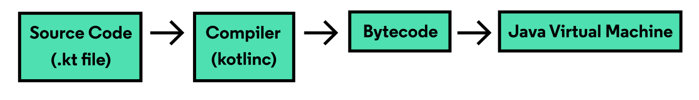
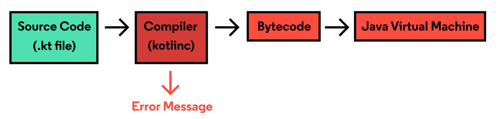
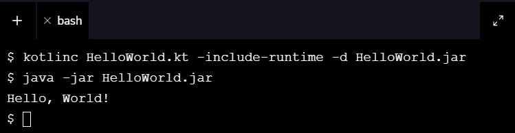

# From Editor to Output

## En una frase

Antes de ejecutarse, tu código Kotlin pasa por el compilador, que lo traduce a bytecode, y la JVM ejecuta ese bytecode instrucción por instrucción.

-----

## Antes de empezar

Conviene que ya sepas:

* Qué es `main()` y cómo se imprime: [Introducción a Kotlin](01-introduccion.md).

Palabras nuevas (también están en el [Glosario](Glosario.md)):

* **Bytecode:** Instrucciones intermedias (archivos `.class`) que genera el compilador y que entiende la JVM.
* **`.jar`:** Archivo que empaqueta muchos archivos compilados en uno solo, listo para ejecutarse con `java -jar`.
* **JVM (Java Virtual Machine):** Programa que ejecuta el bytecode. No entiende Kotlin, solo bytecode.
* **`kotlinc`:** El compilador de Kotlin para usar desde la terminal.
* **Tipado estático:** Los tipos se verifican al compilar, antes de ejecutar. Por eso muchos errores aparecen sin correr el programa.

-----

Aprende qué sucede detrás de escena cuando ejecutas un programa en Kotlin.

¿Cómo funciona un programa? Desde nuestra perspectiva, escribimos algo de código, lo ejecutamos y luego (generalmente) aparece algo en la terminal de salida; sin embargo, esa no es la historia completa. En este artículo, vamos a desglosar todo el trabajo y los procesos que ocurren entre ejecutar nuestro código en Kotlin y ver su resultado.

## **Detrás de escena**

Cuando ejecutamos un programa, una serie de procesos trabajan en conjunto para evaluar y formatear el código según sea necesario. Este proceso varía según el lenguaje, pero en Kotlin se ve así:



Primero, el compilador evalúa todo nuestro programa y se asegura de que no contenga errores. Luego traduce nuestro código fuente a bytecode de Java en forma de archivos `.class`. Estos archivos se pasan luego a la JVM.

JVM son las siglas de Java Virtual Machine (Máquina Virtual de Java) y es el software responsable de ejecutar el bytecode de Java que recibe de un compilador. La JVM no entiende lenguajes de programación como Kotlin; en cambio, se comunica con el bytecode y lo analiza. La JVM ejecuta estas instrucciones en el orden en que fueron dadas. Una vez que la JVM completa la última instrucción, termina su ejecución — lo que significa que nuestro programa se ha ejecutado por completo.

**¿Qué sucede cuando hay un error?**

Dado que Kotlin es un lenguaje de compilación estática, su código se traduce y sus tipos se verifican antes del tiempo de ejecución, específicamente durante la compilación. Cualquier error en nuestro código se detecta durante esta fase. Si el compilador reconoce un error, muestra un mensaje de error en la terminal de salida y termina el resto de los procesos, como se muestra a continuación:



El bytecode nunca se genera, nunca se llega a la JVM y, finalmente, la salida de nuestro código no se muestra. Suponiendo que tenemos un error como este:

```
Error.kt:2:25: error: expecting ')'
  println("Hello, World"
                        ^
```

Hasta que resolvamos este error agregando un `)` y volvamos a ejecutar nuestro código, no podremos ver ninguna salida.

## **¿No tienes un IDE compatible con Kotlin? No hay problema.**

En caso de que estemos fuera de la plataforma de Codecademy y escribamos nuestro código Kotlin localmente en un IDE sin un convertidor integrado entre código Kotlin y Java, podemos recurrir a la terminal bash.

La terminal bash es un intérprete de lenguaje de comandos que tiene la capacidad de ejecutar una serie de comandos contenidos en un script o programa. Con Kotlin instalado, podemos ejecutar una serie de comandos que compilarán manualmente nuestro código, lo ejecutarán y mostrarán su salida. Observa cómo se hace manualmente.

Supongamos que tenemos el siguiente programa en un archivo `HelloWorld.kt`:

```kotlin
fun main() {
  println("Hello, World!")
}
```

En la terminal bash, podemos ingresar el primer comando para compilar nuestro código y guardarlo en un archivo `.jar`:

```bash
$ kotlinc HelloWorld.kt -include-runtime -d HelloWorld.jar
```

- `kotlinc` representa el compilador.
- `HelloWorld.kt` representa el archivo de código fuente que necesitamos compilar a bytecode de Java.
- La opción `-include-runtime` hace que el archivo `.jar` sea ejecutable al incluir la librería runtime de Kotlin dentro de él.
- La extensión `.jar` representa un formato de archivo que indica que muchos archivos Java están comprimidos en uno solo. Cuando se ejecuta, Java puede extraer y usar su información.
- La bandera `-d` especifica la ruta de salida para los archivos de clase recién generados.

Después de presionar Enter, podemos ejecutar nuestro programa con el siguiente comando:

```bash
java -jar HelloWorld.jar
```

- El comando `java` lanza una aplicación escrita en Java. Lo hace iniciando la JVM, cargando el archivo `.class` y ejecutando el código dentro de la función `main()`.
- Al especificar la bandera `-jar`, estamos instruyendo a Java para que ejecute un programa dentro de un archivo `.jar`.



**Nota:** Si realizamos cambios en nuestro código, tendríamos que recompilar nuestro programa y ejecutar los dos comandos anteriores nuevamente.

Has llegado al final del artículo, ¡buen trabajo! Cubrimos una gran cantidad de información que nos permite comprender qué sucede después de ejecutar nuestro código en Kotlin.

Ahora entendemos que nuestro código Kotlin necesita ser compilado a bytecode antes de poder ser transferido a la Máquina Virtual de Java, que ejecuta el código como instrucciones. Los IDE a menudo compilan nuestro código automáticamente, pero si no contamos con esa ventaja, podemos usar una terminal bash para compilar y ejecutar nuestro programa manualmente. La próxima vez que ejecutes tu código, sabrás qué sucede desde el editor hasta la salida. Y si quieres aprender más sobre cómo usar tu terminal bash, echa un vistazo a nuestros cursos de Bash.

-----

## Resumen en 5 líneas

1. El compilador revisa todo el programa y lo traduce a bytecode (archivos `.class`).
2. La JVM ejecuta ese bytecode en orden y termina al llegar a la última instrucción.
3. Kotlin verifica los tipos al compilar: si hay un error, no se genera bytecode y no ves ninguna salida.
4. Sin IDE, compilas con `kotlinc Archivo.kt -include-runtime -d Archivo.jar`.
5. Ejecutas con `java -jar Archivo.jar`; si cambias el código, repites los dos comandos.

-----

## Siguiente lección

Sigue con: [Entorno IntelliJ IDEA](03-entorno-intellij.md).
