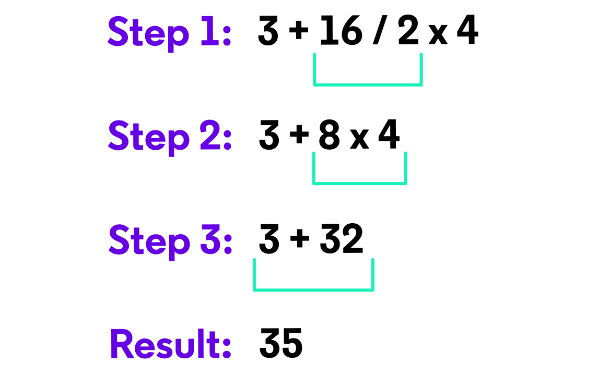

# Using Number Variables

## Number Types

Hemos trabajado brevemente con números enteros en la lección anterior, y en esta sección profundizaremos en los diversos tipos de números que existen en Kotlin.

Los números en Kotlin se dividen en dos categorías: **enteros** y **decimales**, como parte de la superclase `Number`. Observa la imagen de la derecha. Cada libro ocupa cierto espacio en el estante dependiendo de su tamaño. Lo mismo ocurre con los diversos tipos de datos numéricos en Kotlin. Cuanto más grande es una variable en tamaño (bits), más espacio ocupa en la memoria de nuestra computadora.

Los libros del lado izquierdo representan 4 tipos diferentes de datos para un valor entero:

| Nombre | Tamaño (bits) | Valor mínimo | Valor máximo |
|--------|---------------|--------------|----------------|
| Long   | 64            | -9,223,372,036,854... | 9,223,372,036,854... |
| Int    | 32            | -2,147,483,648 | 2,147,483,647 |
| Short  | 16            | -32,768 | 32,767 |
| Byte   | 8             | -128 | 127 |

Una variable `Long` está diseñada para almacenar valores significativamente grandes, mientras que una variable `Byte` no puede almacenar un valor mayor a 127. Por lo tanto, su tamaño y ocupación en memoria varían.

Los libros del lado derecho representan 2 tipos de datos para valores decimales o de punto flotante:

| Nombre | Tamaño (bits) | Precisión de dígitos decimales |
|--------|---------------|-------------------------------|
| Double | 64            | 15-16 |
| Float  | 32            | 6-7 |

Una variable `Double` contiene una precisión decimal más larga y precisa que un `Float`. Por ejemplo:

```kotlin
var doubleNum: Double = 6.0 / 13.0 
var floatNum: Float = 6.0f / 13.0f
println(doubleNum) // Imprime: 0.46153846153846156
println(floatNum)  // Imprime: 0.46153846
```

Al declarar una variable numérica en Kotlin, el compilador determinará cuál de los tipos de datos anteriores asignarle. El tipo predeterminado para números enteros es `Int` y el tipo predeterminado para decimales es `Double`, por lo que trabajaremos más de cerca con estos dos tipos de datos a lo largo de esta lección.

----

## Arithmetic Operators

Los **operadores aritméticos** que existen en Kotlin se parecen a los operadores que conocemos de las matemáticas básicas. Se pueden usar en diversas aplicaciones, desde calcular el promedio de calificaciones de un estudiante hasta determinar el total de una cuenta de restaurante.

Kotlin admite los siguientes operadores aritméticos:

- `+` suma
- `-` resta
- `*` multiplicación
- `/` división
- `%` módulo (divide y da el resto)

Todos los operadores aritméticos anteriores, excepto el módulo (`%`), deberían resultarte familiares. El módulo es un símbolo de programación que se usa para calcular la división y devolver el resto. Por ejemplo:

```kotlin
println(7 % 2) 
```

7 se divide por 2 y da como resultado 3 con resto 1. Luego, el resto se devuelve y se imprime en la terminal:

```
1
```

Una forma muy común de usar `%` es comprobar si un número es par o impar:

```kotlin
val numero = 25

println(numero % 2) // Imprime: 1
```

La regla es simple:

- Si `numero % 2` da `0`, el número es par.
- Si `numero % 2` da `1`, el número es impar.

Otro ejemplo directo:

```kotlin
val residuo = 25 % 7
println(residuo) // Imprime: 4
```


Dentro de la declaración `println()` anterior, construimos una **expresión aritmética**. Una expresión aritmética es la agrupación de operadores aritméticos y valores numéricos. Observa algunas de las formas en que podemos configurar y usar expresiones aritméticas en un programa Kotlin.

**Con variables:**
```kotlin
var operand1 = 5.5
var operand2 = 4.3
println(operand1 + operand2) 
// Imprime: 9.8
```

**En una declaración de impresión:**
```kotlin
println(8 - 4) 
// Imprime: 4
```

**Concatenado dentro de un String:**
```kotlin
println("The quotient of -9 and 3 is " + -9 / 3) 
// Imprime: The quotient of -9 and 3 is -3
```

**Dentro de las `{}` de una plantilla de cadena:**
```kotlin
println("The product of 6 and 2, is ${6 * 2}") 
// Imprime: The product of 6 and 2 is 12
```

----

## Order of Operations

Como vimos en el ejercicio anterior, Kotlin nos permite combinar o encadenar expresiones aritméticas para lograr cálculos más complejos. Al hacerlo, debemos tener en cuenta el orden en que se evalúa cada expresión.

La mayoría de los lenguajes de programación siguen un cierto orden de operaciones (similar a PEMDAS) al evaluar dichas expresiones. En Kotlin, este orden es:

1. Paréntesis
2. Multiplicación
3. División
4. Módulo
5. Suma
6. Resta

Puede que hayas notado que omitimos la E (Exponentes) en PEMDAS. Esto se debe a que Kotlin no tiene un operador de exponente y, en su lugar, utiliza la función `.pow()` para calcular la potenciación. Veremos esto más a fondo en el siguiente ejercicio.

Veamos algunos ejemplos de expresiones aritméticas compuestas:

```kotlin
println(5 + 8 * 2 / 4 - 3) // Imprime: 6 
println(3 + (5 + 5) / 2)   // Imprime: 8
println(3 * 2 + 1 * 7)     // Imprime: 13
```

Otra regla a tener en cuenta es cuando una expresión contiene operaciones del mismo nivel, como multiplicación y división, o suma y resta, una al lado de la otra. El compilador evaluará esta expresión en orden de izquierda a derecha. Por ejemplo:

```kotlin
println(3 + 16 / 2 * 4) // Imprime: 35
```

Dado que tenemos división (`/`) y multiplicación (`*`) una al lado de la otra, el orden de izquierda a derecha entra en vigor y la expresión se evalúa de la siguiente manera:




En resumen: si una operación debe ejecutarse primero, usa paréntesis. No lo dejes a la memoria ni a la suerte. El código debe ser claro.

```kotlin
val operacion1 = 10 + 5 * 2
println(operacion1) // Imprime: 20

val operacion2 = (10 + 5) * 2
println(operacion2) // Imprime: 30
```

En `operacion1`, Kotlin multiplica primero. En `operacion2`, los paréntesis obligan a sumar antes de multiplicar.

Ten en cuenta ambos conjuntos de reglas cuando crees expresiones aritméticas complejas.

-----

## Augmented Assignment Operators

A medida que construimos nuestros programas, a menudo necesitaremos actualizar los valores de las variables después de ciertos cálculos. Supongamos un programa que aumenta la velocidad actual de un vehículo para alcanzar un límite de velocidad de 55:

```kotlin
var currentSpeed = 45 
currentSpeed = currentSpeed + 10
print(currentSpeed) // Imprime: 55
```

Para aumentar y actualizar el valor de `currentSpeed`, hemos sumado 10 a `currentSpeed` y lo hemos reasignado nuevamente a `currentSpeed`. Kotlin proporciona una sintaxis aún más corta para operaciones como esta con **operadores de asignación aumentada**.

Los operadores de asignación aumentada ejecutan un cálculo y reasignan su resultado a una variable en un solo paso. Cada uno consiste en un operador aritmético seguido inmediatamente del operador `=`. Observa la diferencia en las sintaxis:

**Sintaxis larga:**
```kotlin
a = a + b
```

**Sintaxis corta con un operador de asignación aumentada:**
```kotlin
a += b
```

Aquí tienes un desglose de cada uno:

| Operación | Sintaxis larga | Sintaxis corta |
|-----------|----------------|----------------|
| Suma | `a = a + b` | `a += b` |
| Resta | `a = a - b` | `a -= b` |
| Multiplicación | `a = a * b` | `a *= b` |
| División | `a = a / b` | `a /= b` |
| Módulo | `a = a % b` | `a %= b` |

Teniendo en cuenta la sintaxis corta, ahora podemos refactorizar y optimizar nuestro programa anterior a su estado final y conciso:

```kotlin
currentSpeed += 10
println(currentSpeed) // Imprime: 55 
```

🚗💨

----

Ejemplo práctico con varios operadores:

```kotlin
var contador = 10

contador += 1 // contador ahora es 11
contador -= 2 // contador ahora es 9
contador *= 2 // contador ahora es 18
contador /= 2 // contador ahora es 9
contador %= 2 // contador ahora es 1
```

Estos operadores no hacen magia: solo reducen una operación repetitiva. `contador += 1` significa exactamente `contador = contador + 1`.

-----

## Increment and Decrement Operators

Además de los operadores de asignación aumentada, Kotlin nos proporciona dos atajos aritméticos que se pueden usar para realizar cálculos rápidos de suma y resta. Estos se conocen como **operadores de incremento y decremento**.

Un **operador de incremento** representa la suma de 1 a una variable usando dos signos más consecutivos, `++`:

```kotlin
variableName++
```

El **operador de decremento** representa la resta de 1 a una variable usando dos signos menos consecutivos, `--`:

```kotlin
variableName--
```

Esta sintaxis abreviada es muy útil con **bucles** y **condicionales** (conceptos que exploraremos más adelante en este curso). Por ahora, familiaricémonos con la sintaxis.

Supongamos que estamos escribiendo un programa que lleva la cuenta de cuántas manzanas tenemos en nuestra cesta mientras recogemos manzanas. 🍎

```kotlin
var apples = 5
```

Recogimos una manzana Gala, así que agreguemos 1 a nuestra cesta usando un operador de incremento:

```kotlin
apples++ 
println(apples) // Imprime: 6
```

Comimos una manzana Honey Crisp de nuestra cesta, así que restemos 1 del total:

```kotlin
apples-- 
println(apples) // Imprime: 5
```

**Nota:** `++` y `+= 1` son las mismas operaciones y se pueden usar indistintamente en todo un programa.

-----


## Ejemplos prácticos con números

Los operadores aritméticos sirven para resolver cálculos reales dentro de una aplicación: totales, promedios, porcentajes, estimaciones e incrementos.

### Calcular un incremento porcentual

Supongamos que quieres comparar cuántos emails se enviaron hoy frente a ayer:

```kotlin
val emailsHoy = 12
val emailsAyer = 8

val porcentajeIncremento = ((emailsHoy - emailsAyer) / emailsAyer.toDouble()) * 100

println("Incremento: $porcentajeIncremento%") // Imprime: Incremento: 50.0%
```

Usamos `toDouble()` para evitar una división entera. Si trabajas con porcentajes, necesitas conservar los decimales.

### Estimar valores con variables

También puedes combinar operaciones para proyectar datos:

```kotlin
val emailsRecibidos = 15
val emailsEnviados = 25

val emailsPorSemana = (emailsRecibidos + emailsEnviados) * 7

println(emailsPorSemana) // Imprime: 280
```

Primero sumamos los emails diarios y luego multiplicamos por 7. Los paréntesis hacen explícita la intención del cálculo.

-----

## The Math Library

Para cálculos matemáticos más complejos, podemos hacer referencia a la librería `Math`, que se hereda de Java. Consiste en varias funcionalidades matemáticas que abarcan temas como logaritmos, trigonometría, estadística y más. Veamos algunas de las funciones más utilizadas que proporciona.

- **`Math.pow()`** devuelve el primer valor elevado a la potencia del segundo valor. Acepta y devuelve valores `Double`.

```kotlin
Math.pow(5.0, 3.0) // 125.0
```

- **`Math.min()`** devuelve el valor mínimo entre dos números dados.

```kotlin
Math.min(5, 3) // 3
```

- Alternativamente, **`Math.max()`** determina el valor máximo.

```kotlin
Math.max(5, 3) // 5
```

- **`Math.random()`** devuelve un número generado aleatoriamente entre 0 y 1.

```kotlin
Math.random() // 0.3335735290527727
```

- **`Math.round()`** acepta un único valor `Double` y devuelve el resultado de redondear ese valor al entero más cercano.

```kotlin
Math.round(15.7) // 16
```

----

## Summary

¡Excelente trabajo! Has completado la lección final sobre **variables** y has aprendido los fundamentos de los números en Kotlin. Repasemos lo que vimos.

- La superclase `Number` contiene los tipos de datos `Int`, `Long`, `Short`, `Byte`, `Float` y `Double`.
- Los **operadores aritméticos** compatibles con Kotlin incluyen `+`, `-`, `*`, `/` y `%`.
- Los **operadores de asignación aumentada** incluyen un operador aritmético y uno de asignación, utilizados para calcular y reasignar un valor en un solo paso.
- El **operador de incremento** incluye dos signos más consecutivos, `++`, que se usan para sumar 1 a un valor y reasignar el resultado.
- El **operador de decremento** incluye dos signos menos consecutivos, `--`, que se usan para restar 1 a un valor y reasignar el resultado.
- El **orden de las operaciones** incluye: paréntesis, multiplicación, división, módulo, suma y resta.
- La librería `Math` se hereda de Java y contiene varias **funciones matemáticas** para usar en un programa Kotlin.
- El operador `%` permite obtener residuos y es útil para detectar números pares o impares.
- Para porcentajes, convierte al menos un valor a `Double` o `Float` para conservar decimales.

Siéntete libre de utilizar el archivo vacío `Review.kt` y la terminal de salida de la derecha para perfeccionar tu comprensión de los números y practicar la escritura de código en Kotlin.

-----